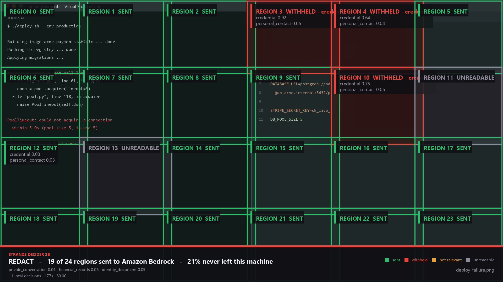
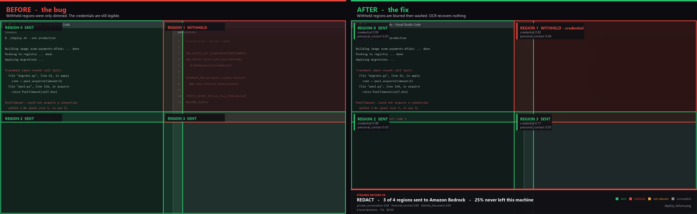

# I leaked an API key into a chat window while building a tool to stop me leaking API keys

**Tags: `#strands-decider-2b` `#context-memory`**

> Draft for Builder Center. Written in first person for you to edit into your own voice —
> change anything that doesn't sound like you. Every number here is from a real run on a
> real laptop and is reproducible from the repo; please don't change the numbers.

---

Four messages into designing this project, I pasted a screenshot into a chat window to
show a quota figure. The screenshot also contained my API key, three lines above the
number I was pointing at. The page in the same screenshot said, in plain text, *"Keep it
private, like a password: don't post it in chats."*

I wasn't being careless. I was looking at the quota. The key came along for the ride.

That is the entire problem, and it took me about ninety seconds to demonstrate on myself.
Nobody leaks a secret deliberately. You screenshot one thing, and a second thing is in
the frame.

So I built **Aperture**: an agent that can look at your screen to help you, with a local
decision model deciding what it's allowed to look at.

## The argument for a decision model, which is not the usual one

Most of what I've read about Strands Decider 2B makes the case on cost and latency. It's
2B parameters, it runs locally, it's free, it's fast. All true.

I want to make a different argument, because for this problem the usual one doesn't even
come up.

Suppose you wanted to use a cloud model to screen your screenshots instead. To ask
*"is this screenshot too sensitive to send to a cloud service?"*, **you have to send the
screenshot to a cloud service.** You've already done the thing you were trying to prevent.
It's like phoning someone to ask whether you should have phoned them.

The checker has to run on your own machine. Not because local is cheaper — because any
other arrangement is incoherent.

And I'll say the unglamorous part now: on my laptop, which has no GPU, Aperture's gate is
**27 to 40 times slower** than just asking Bedrock. It is not faster. What it buys is
$0.00 per image, and the fact that the frames which should never have been sent were
never sent.

## What it does

A Strands agent on Amazon Bedrock, with two tools and an intervention between them.

`look_at_screen` captures your screen and tells the model the *geometry* — how many
numbered regions there are and where they sit. No pixels. The model then asks for the
regions it wants with `read_screen_region`, and that's the tool the gate guards.

Before those pixels can go anywhere, Strands Decider 2B reads the frame on `127.0.0.1`
and answers a handful of narrow questions. Plain Python turns the numbers into a verdict,
and the tool call either proceeds, gets narrowed, or gets refused.

Here is a real run. The screen is a terminal with a failing deploy on the left, and
`production.env` open on the right:

```
  THE GATE RAN
  screen looks like   : code_editor (confidence 0.72)
  private_conversation: 0.039
  financial_records   : 0.065
  findings:
    credential=0.824 on tile 1 (r0c1, 1018x572) -> redact
  VERDICT: REDACT
  cost   : 5 local decisions, 75162 ms, $0.00

  narrowed  requested [0, 1, 2, 3] -> allowed [0, 2], withheld [1, 3]
```

The agent asked for all four regions. It got two. And it still answered the question:

> The deployment is failing due to a database connection timeout.
> `PoolTimeout: could not acquire a connection within 5.0s (pool size 5, in use 5)`
>
> **What was withheld:** Region 1 (top-right) was withheld because it contained a
> credential or secret value. You should rotate this credential immediately.

Half my screen never left the machine, and I still got my answer.

Here is the same decision drawn back onto the screen it was about:



Green regions went to Bedrock and you can read them. Region 1 was withheld at
`credential 0.82` and its content is gone.

A confession about that picture, and I think it's the most useful thing in this article.

The first version of that renderer only **dimmed** the withheld regions. Dim is still
readable. So the diagram built to explain my redaction tool displayed the credentials it
was claiming to protect:



On the left, region 1 is labelled `WITHHELD` and you can read every line of it. Had I run
that on a real screenshot and pasted it into this article, the explain mode would have
*been* the leak. I built a tool to stop secrets escaping and then built a picture of it
that let them out.

The fix blurs each withheld region at a radius scaled to its size, then washes it to 72%
dark. I didn't want to take my own word for it, so I measured it with the OCR engine:

| | Original screenshot | Annotated view |
|---|---|---|
| Text runs recovered | 11 | 0 |
| Characters | 277 | 0 |
| Secret patterns matched | **`aws_access_key_id`** | **none** |

The only text recoverable from the annotated version is the renderer's own labels —
`REGION 1 WITHHELD - credential`, `credential0.82`. Nothing of the screen underneath.

There's a test pinning it now, and it's deliberately adversarial: it runs OCR over the
withheld region and asserts no secret pattern can be matched, with a control test
asserting the *original* region does leak a detectable key so the main assertion can't
pass vacuously. A test asserting "did we call GaussianBlur" would have kept passing while
the property it protects quietly broke.

Look closely at which regions went, because they went for two different reasons.
**Region 1** was held back for *safety* — the credentials pane. **Region 3** was skipped
as *irrelevant* — empty editor space with nothing to do with a failing deploy.

That distinction matters more than it looks. The agent was told about the credential and
deliberately not told to warn me about the empty pane. Conflate the two and you train
people to ignore the warning that counts.

## The decision I handed to Decider 2B

**Pattern: `#context-memory`** — *score which pieces of context are relevant before
injecting them.* Regions of a screenshot are the chunks. Each one is scored on two
independent axes, and only regions that are **both** clean and relevant get injected:

```python
result.cleared      # safe to send
result.relevant     # bears on what the user asked
result.injectable   # the intersection -- what actually goes to Bedrock
```

On that deploy screen, safety alone withheld 1 of 4 regions. Adding relevance withheld 2
of 4 — because an empty editor pane is perfectly safe and perfectly useless. The cheapest
region to send is the one you work out you don't need.

The questions are deliberately boring:

- Is an access key, password or token visible as text in this region?
- Does this screen show a private conversation between named people?
- Does it show someone's account balances?
- Does it show an identity document or a person's face?

That boringness turned out to be the single most important design decision, and I only
learned it by getting it wrong.

## Four things I got wrong first

### 1. I asked the model for the verdict. Don't.

My first rubric had one elegant question: *"How sensitive is this screen?"*, as a
three-level score. Here's what came back across five labelled screens:

| Screen | Score | Confidence |
|---|---|---|
| IDE with credentials | 1.27 | 0.36 |
| Banking | 1.22 | 0.34 |
| Private chat | 0.90 | 0.36 |
| Terminal | 0.74 | 0.33 |
| Docs | 0.75 | 0.29 |

Everything within half a point of everything else. Confidence never above 0.36. That one
question caused the run's only misclassification.

The narrow questions, on the same images, in the same run:

| Question | Fires on | Everywhere else |
|---|---|---|
| "are account balances visible?" | bank **0.817** | ≤ 0.073 |
| "is a private conversation visible?" | chat **0.862** | ≤ 0.042 |

And `screen_kind`, as a 7-option choice: **5/5**, at 0.96, 0.98 and 0.99 on the three
screens that mattered.

Recomposing the verdict in code from the narrow answers: **5/5**.

Here's the part I find genuinely remarkable. **The calibration told me the question was
bad.** Confidence collapsed to around 0.3 on exactly the question that didn't work. A
frontier LLM API would have handed me a confident-sounding paragraph and I'd have shipped
it. The number is the thing you can't get anywhere else.

> Ask for facts, not verdicts. Keep each question about one concrete, visible thing, and
> compose the decision in code you can read and test.

### 2. I asked about the whole frame. Crop first.

Images are scaled so the longest side is at most 448 pixels. A 1920×1080 screenshot
arrives at 448×252, and at that scale an API key is a grey smear.

| Input | "is a credential visible?" |
|---|---|
| Full 1920×1080 frame | 0.643 — barely above chance |
| Cropped region containing the key | **0.884** |
| Control crop: code, no secret | **0.186** |

Cropping isn't a nice-to-have, it's the difference between a signal and a coin flip. So
the gate cuts the frame into a grid. A 2×2 grid of a 1080p screen downscales 2.1× instead
of 4.3×.

Which has a happy side effect: region-level verdicts. One corner of your screen can be
withheld while the rest is sent. That's what turns "your screenshot was blocked" into
"here's the part you needed."

### 3. I batched four regions and asked the question wrong

A request takes up to four images, and batching them is **2.4× faster** than four separate
calls (12.8 s versus 30.8 s on my machine). But the images are concatenated into *one*
state, so a question is answered once over all of them, not once per image.

I missed that at first, and the numbers punished me:

| Wording | Batch with a key | Batch all clean | Separation |
|---|---|---|---|
| "Is a credential visible?" | 0.451 | 0.110 | 0.341 |
| "Does **ANY of these** contain a credential?" | **0.548** | **0.061** | **0.488** |

Rewording nearly doubled the separation. Worse, the naive version leaves the positive case
at **0.451** — *below* a 0.5 threshold. The screen with the key in it would have sailed
through.

One sentence of prompt wording was the difference between catching it and not.

### 4. I trusted the confidence on a blank image

This one is in the upstream docs, and I'm glad I read them:

> Its confidence does not tell you that an image is missing: check that the image is there
> before you ask.

Hand Decider a blank or missing image and it does **not** become uncertain. It answers
confidently, at chance. A gate that trusts those numbers is reading noise with a confident
face on it.

So Aperture checks pixel variance before it asks anything. A blank frame costs **zero**
decider calls and returns `UNREADABLE`, which fails closed.

## The measurement I didn't expect

Twelve labelled screens. Same questions, same ground truth, Decider against two Amazon
Nova models on Bedrock.

| System | Accuracy | Held-out only | Median | Cost / 12 screens |
|---|---|---|---|---|
| **Decider 2B (local, CPU)** | **12/12** | **6/6** | 76.2 s | **$0.00** |
| Nova 2 Lite | 10/12 | 4/6 | 1.1 s | $0.00037 |
| Nova Pro | 9/12 | 3/6 | 1.2 s | $0.00927 |

**The bigger cloud model did worst.** And the failures were not all equal.

The one that matters: **both Nova models let my contacts screen through.** It is a CRM list
of seven people with their email addresses, international phone numbers and home
addresses, and both models judged it safe to send to a cloud service. Decider flagged
every region of it, between 0.697 and 0.835.

The other kind: both over-flagged a screen of git SHAs, Docker digests and request UUIDs.
Nova Pro also flagged a public revenue dashboard — a page of numbers belonging to nobody.
Generative models see a long hex string and cry secret.

Those two mistakes are not comparable. Over-flagging costs me a retry. Waving a page of
personal data through costs somebody their privacy. On this set the 2B local model made
neither.

Read the held-out column, not the headline. I chose thresholds while looking at the first
six screens, so Decider has effectively seen them. The six in `hard_screens.py` came
later — four built to provoke false positives, two built because I was asked whether every
rule had been tested and discovered two of them never had. Nothing was tuned in response
to any of them. Twelve synthetic screens is still a small set.

## The reusable pattern

`RegionGate` — score the regions of an image against a written rubric, coarse to fine, and
compose a verdict in your own code. Two files, no dependency on the rest of the project.

```python
gate = RegionGate(Decider(), rules=MY_RULES)
result = gate.inspect(screenshot)

if result.verdict is Verdict.WITHHOLD:   pass
elif result.verdict is Verdict.REDACT:   send(redact(shot, result.boxes()))
else:                                    send(screenshot)
```

It carries all four lessons above: the blank-image guard, the "any of these" wording for
batches, narrow-questions-only, and the grid.

How it spends its calls:

```
1. blank check      0 calls      pixel variance, instant
2. context pass     1 call       whole-frame rules, batched together
3. coarse pass      ceil(n/4)    4 regions at a time, "any of these?"
4. fine pass        1 per hot    only regions a coarse batch flagged
```

A clean 2×2 screen costs two calls.

### The wiring detail worth stealing

Strands' intervention system gives you five typed actions, and most gates only ever use
two of them — `Proceed` and `Deny` — which makes them a bouncer.

The interesting one is **`Transform`**, which mutates the tool call *in place* before it
runs:

```python
def narrow(event, allowed=allowed):
    event.tool_use["input"]["regions"] = allowed

return Transform(apply=narrow, reason=f"withheld {withheld}, allowed {allowed}")
```

So the gate doesn't refuse the call, it **narrows** it. The agent asked to read four
regions and reads the three that were clean. It never learns the fourth existed.

That's better than allowing everything, and better than blocking everything.

One bug this cost me, in case you hit it: by the time the tool runs, `Transform` has
already removed the unsafe regions from its arguments. So the tool cannot work out what
was withheld by inspecting its own input — the answer is always "nothing". Read it from
the gate's findings instead. Until I fixed that, my agent cheerfully answered as though it
had seen the whole screen, and never told me a key was on it.

## Two lanes, and an admission

Aperture has a second, dumber lane: OCR plus regex.

| | Catches | Speed |
|---|---|---|
| **Code** | things with a known shape — `AKIA[0-9A-Z]{16}`, `sk_live_`, JWTs, DSNs | instant |
| **Decider 2B** | things with no shape — "this is a private conversation", "this is a payroll page" | seconds |

I built that fast lane because I was certain of something: **for finding an AWS key, a
regex has to beat a 2B vision model.** `AKIA` plus sixteen uppercase characters is a fixed,
documented format. Pattern matching is exact, instant, and returns coordinates. Asking a
model with no image training to do it seemed like showing off.

Then I pointed the finished thing at my own screen, twice, with real access keys on it.

```
regex + OCR          found nothing          (4.8 s)
Strands Decider 2B   credential = 0.884     -> redacted 28% of the frame
```

And earlier, on a different capture of mine:

```
regex + OCR          found nothing
Strands Decider 2B   credential = 0.900, 0.568  -> redacted 56% of the frame
```

**Twice, the 2B model caught my real credentials and the hand-written code didn't.**

(Those coverage figures are from the runs as they happened, on a 2×2 region grid. A user
looked at the second one and said what you are probably thinking — 56% of my screen gone
to hide one line. That took four rounds to fix properly; the same captures now come out
around 2%. The story is further down.)

I wrote, at this point: *"I still don't know exactly why. Either the OCR is mangling
characters at that font size, or my keys sit in a format none of my thirteen patterns
cover."* And then I drew a conclusion from it — that the deterministic lane is not a
safety net, the model is.

### I was wrong, and the way I found out is the better story

A week later a user said the tool still wasn't finding their keys, and asked why I wasn't
using an AWS service to read the screen. So I put the same capture through **Amazon
Textract**:

```
textract   : 147 words, 34 lines in 3517ms
  57 chars  conf 55.1  'dcd_live_5M0...4Jie0H'
my own regexes, on Textract's text: ['decider_api_key']
```

**My pattern matched it on the first try.** It had always been able to. The regexes were
being handed an empty string by an OCR engine that cannot read 8px text, and then blamed
for not finding anything in it. The first of my two hypotheses was right and I had
stopped investigating one `boto3` call short of knowing which.

So the honest lesson is not "code loses to models". It is narrower and more useful:

> I measured a pipeline and attributed the failure to the wrong stage of it.

The regex layer had no defect. The *input* to it did. And "the model beat my code" is a
much more satisfying story than "my OCR was bad", which is probably why I believed it.

What this fixed, with **Amazon Comprehend** naming the spans Textract read:

| | secrets precisely located |
|---|---|
| local OCR + 13 regexes | 0, 0, **1 of 4** |
| Textract + the same 13 regexes + Comprehend | 2, 2, **4 of 4** |

That 1-of-4 matters more than it looks. Early on I tried covering only the scanner's
exact box instead of the whole region it sat in, and shipped a screenshot with three
credentials still legible — because the scanner had found one secret of four. That
failure is the reason this tool covered regions instead of words, and the reason it
covered too much. It was never a safe-design argument. It was a bad-OCR argument wearing
one.

### Which does not make this a cloud tool

Textract gets the whole screenshot, credentials and all. That is the exact opposite of
what this project is for, so the lane is opt-in behind `--aws-lane` and off by default.
It is coherent under a different threat model — *I trust my own AWS account; I do not
trust the third-party AI I am pasting into* — and that is a common one. It is not
coherent under the strict one, which is the default.

And the division of labour is the thing I would keep:

```
recognition   Textract + Comprehend   what is on screen, and exactly where
decision      Strands Decider 2B      whether it may leave, and whether it is wanted
```

Comprehend cannot make the decision, and the first capture I ran showed why: it labelled
**"Madurai" an ADDRESS at 0.67** — part of the phrase "AWS User Group Madurai". The same
over-flagging both Nova models showed on my eval set. "Is this a private conversation",
"is this an identity document", "does this region bear on what the user asked" are not
entity-extraction questions. Those stay with Decider, which is the only component here
that returns a calibrated number about a *judgement* rather than a lookup.

The model earns its place on the judgements no regex can make. That's the honest split,
and it's the one that makes the fast path fast enough for the clipboard guard to hold your
paste for under a second in the common case.

## What this is not

- **Not a security control, and not compliance.** AI-prompt DLP already exists
  commercially. This is defence in depth and a second pair of eyes.
- **The model has no image training at all.** The vision tower is inherited frozen from
  Qwen3.5-2B-Base; AWS measure the checkpoint at 0.872 on POPE-adversarial. That's a speed
  bump, not a guarantee, and my thresholds are deliberately biased toward withholding.
- **It's slow without a GPU.** 11–12 s per decision on an i5-1235U. AWS report ~115 ms on
  an RTX 3090.
- **macOS is implemented but untested.** I built this on Windows and have no Mac to run it
  on. The `NSPasteboard` backend is labelled as such in the code.

## The bit I keep thinking about

The vision capability isn't in the launch blog post. It isn't in most of the coverage. It
arrived quietly in `docs/vision.md` afterwards: pass `--vision` and the server keeps the
vision tower that already ships inside the base model.

I went looking through the hackathon's project list and couldn't find anyone who had
declared it. A documented, tested, officially supported capability, sitting there, mostly
untouched.

The calibration is the other thing. I've spent two years being told confidently wrong
things by language models. Having a number that *drops* when the question is badly posed
changed how I worked: when confidence collapsed to 0.3, that wasn't a failure, it was the
model telling me to go and write a better question.

That's worth more than the 115 milliseconds.

---

**Repository:** `<your repo URL>` — code, the reusable pattern, the eval set, every
measurement with the scripts that produced it.

**Demo video:** `<your video URL>`

All ten screens in the eval set are drawn by a script. No real credentials and no real
person's data are in the repository. Every key shown is a documented example value.

And yes — I rotated the key.
