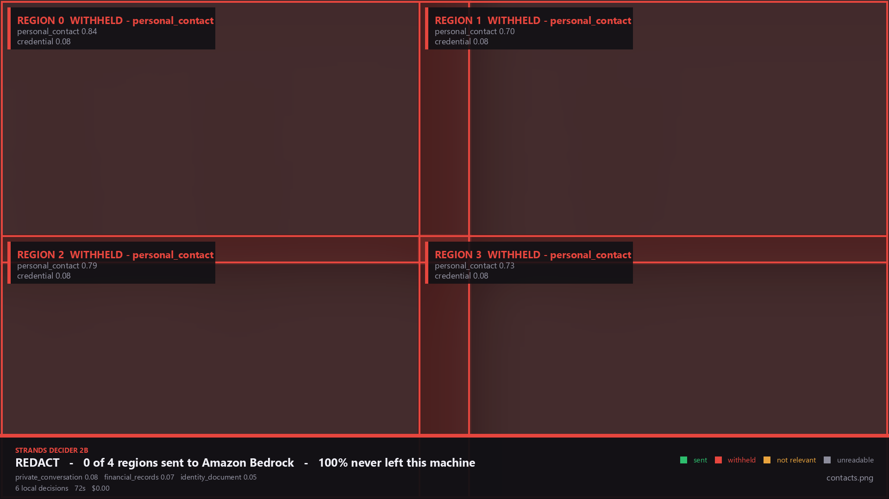

# Aperture

**A local model decides how much of your screen is allowed to reach a cloud model.**

Built for the [Agent Experience Hackathon: Strands Decider](https://builder.aws.com/build/hackathons/4f50957c-1d08-37ab-b11c-97516b9adeb4/agent-experience-hackathon).

`#strands-decider-2b` `#context-memory`

---

## The thing that happens

You hit an error. You screenshot your terminal and paste it into an AI chat to ask what
went wrong. The screenshot also caught the editor pane next to it, with `production.env`
open, with your AWS key in it.

You weren't careless. You were looking at the error. The key came along for the ride, and
now it's on somebody else's servers.

This happened to the author of this repo *while building this repo* — a screenshot pasted
into a chat window to show a quota number, with an API key three lines above it, on a page
that said "don't post this in chats."

## What Aperture does

A Strands agent that can look at your screen to help you, with **Strands Decider 2B**
sitting in its path deciding what it may look at.

Every region of the screen is scored on **two independent axes**:

- **Is it safe to send?** — credentials, private conversations, financial records, faces
- **Is it worth sending?** — does this region bear on what the user actually asked

Only regions that are *both* reach Bedrock. That intersection is the `#context-memory`
decision, and it is why most of a screen usually stays put even when nothing on it is
sensitive.

```
you ──► agent (Amazon Bedrock) ──► "let me look at your screen"
                                        │
                        ┌───────────────▼────────────────┐
                        │  127.0.0.1  — Decider 2B       │
                        │  scores each region of the      │
                        │  screen; your code decides      │
                        └───────────────┬────────────────┘
                                        │ only cleared regions
                                        ▼
                               Amazon Bedrock reads them,
                               diagnoses, writes the fix
```

The decision about what may leave the machine is made somewhere it **cannot** leave from.

## Why a decision model and not an LLM

Because asking a cloud model whether a screenshot is too sensitive to send to a cloud
model requires sending it the screenshot. You have already done the thing you were trying
to prevent.

That isn't an optimisation argument, it's a logical one. Which is also why Aperture does
*not* claim to be faster: on the author's GPU-less laptop it is **27–40× slower** than
asking Bedrock. What it buys is $0.00 per image, and the fact that the frames which should
never have been sent were never sent.

---

## It works

Real run, against the demo screen — a terminal error on the left, `production.env` on the
right:

```
$ aperture ask "my deploy is failing, what's wrong?" --screen evalset/out/deploy_failure.png

  THE GATE RAN
  screen looks like   : code_editor (confidence 0.72)
  private_conversation: 0.039
  financial_records   : 0.065
  findings:
    credential=0.824 on tile 1 (r0c1, 1018x572) -> redact
  VERDICT: REDACT
  cost   : 5 local decisions, 75162 ms, $0.00

  WHAT THE AGENT SAID
  The deployment is failing due to a database connection timeout...
  PoolTimeout: could not acquire a connection within 5.0s (pool size 5, in use 5)

  **What was withheld:**
  Region 1 (top-right) was withheld because it contained a credential or secret
  value. You should rotate this credential immediately.

  narrowed  requested [0, 1, 2, 3] -> allowed [0, 2], withheld [1, 3]
```

The agent asked for all four regions and got two. It still solved the problem, and told
the user what it couldn't see and what to do about it.

### See the decision

```bash
aperture check evalset/out/deploy_failure.png --explain explained.png
```


The region grid with every score the gate actually got. Green regions were sent and
their content is legible. Region 1 was withheld at `credential 0.82` and its content is
destroyed — blurred and washed, not merely dimmed, because the first version of this
renderer displayed the credentials it was claiming to protect.

A screen where nothing can be salvaged looks like this instead:



Seven people's emails, phone numbers and home addresses. **0 of 4 regions sent, 100% kept
local.** Both Amazon Nova models judged this screen safe to send.

Note the two kinds of withholding in that last line, because they are different
decisions. **Region 1** was held for *safety* — the credentials pane. **Region 3** was
skipped as *irrelevant* — empty editor space that had nothing to do with a deploy error.
The agent was told about the first and deliberately not warned about the second.

Half the screen never left the machine, and only one half of that was for safety
reasons. The rest was simply not worth sending.

## How little it covers

The first working version of this tool blacked out **56% of a screen** to hide one line of
credentials. A user reported that as a bug four times before it was properly fixed, and
each round was a different idea about the same question:

| | Covered | What changed |
|---|---|---|
| whole frame | 56% | — |
| 2×2 regions, subdivide what fires | 24% | ask the model again, smaller |
| **6×4 regions** | 15% | stop making the regions big in the first place |
| **+ mesh** | **6%** | stop asking the model where the pixels are |

The last one is the interesting one, and it came from the user, who sent a picture of
graph paper and said it should work like that. A graph-paper mesh is hundreds of squares
and the model costs ~12 s a question, so the mesh cannot be something it is asked about.
It doesn't have to be — two different questions had been conflated the whole time:

```
WHERE IS THERE SOMETHING SENSITIVE?   a judgement   only the model can answer it
WHERE ARE THERE PIXELS?               arithmetic    free, exact, nothing to fool
```

`credential 0.915 on region 3` is not a location. So the regions the model flags are
meshed into 14px squares, each square is measured, and only the ones that aren't
background get painted. **The claim is unchanged — everything in this region goes — the
empty half of a code pane simply stopped counting as "everything".** No model call, about
4 ms, and the credential is still fully covered while the file tree, the terminal and the
title bar all survive.

This looks like the mistake this project already made and reverted — narrowing a flagged
region to the regex scanner's matched box, which left three credentials legible because
the scanner matched one secret of four. The difference is the whole point:

- narrowing to a **regex hit** covers the secrets the scanner *recognised*
- narrowing to **inked squares** covers every pixel that is *not background*

A secret cannot hide in blank space, so dropping only blank space cannot expose one.
There is no key format, line wrap or font size that defeats it. Full write-up, thresholds
and fail-safe paths: [`research/README.md` §13–14](research/README.md).

`--no-mesh` paints whole rectangles if you want the old behaviour.

## Measured against Amazon Nova

Twelve labelled screens, same questions, same ground truth
([`evalset/bench.py`](evalset/bench.py), raw output in `evalset/results.json`):

| System | Accuracy | Held-out only | Median | Cost / 12 screens |
|---|---|---|---|---|
| **Decider 2B (local, CPU)** | **12/12** | **6/6** | 76.2 s | **$0.00** |
| Nova 2 Lite (Bedrock) | 10/12 | 4/6 | 1.1 s | $0.00037 |
| Nova Pro (Bedrock) | 9/12 | 3/6 | 1.2 s | $0.00927 |

The *larger* cloud model did worst, and the failures split into two very different kinds:

**The dangerous kind.** Both Nova models **let the contacts screen through** — a CRM list
of seven people with email addresses, international phone numbers and home addresses. They
judged it safe to send. Decider flagged all four regions of it, 0.697 to 0.835.

**The annoying kind.** Both over-flagged a screen full of git SHAs, Docker digests and
request UUIDs; Nova Pro also flagged a public revenue dashboard. Generative models see a
long hex string and cry secret.

A gate that over-flags costs you a retry. A gate that waves personal data through costs
you an incident. Decider made neither mistake on this set.

**Read the held-out column, not the headline.** Thresholds were chosen while looking at the
first six screens, so Decider has effectively seen them. The six in `hard_screens.py` were
written afterwards — four to provoke false positives, two to cover rules that had shipped
with no test image at all — and nothing was tuned in response. Twelve synthetic screens is
still a small set.

---

## The reusable pattern

[`aperture/patterns/`](aperture/patterns/README.md) — **`RegionGate`**, the required
reusable asset, with no dependency on the rest of this project.

Score the regions of an image against a written rubric, coarse to fine, and compose a
verdict in your own code. Wire it into a Strands agent with the included
`InterventionHandler`.

```python
gate = RegionGate(Decider(), rules=MY_RULES)
result = gate.inspect(screenshot)

if result.verdict is Verdict.WITHHOLD:   ...                       # send nothing
elif result.verdict is Verdict.REDACT:   send(redact(shot, result.boxes()))
else:                                    send(screenshot)
```

It carries four things that are easy to get wrong, each one measured:

1. **It checks the image is really there.** The upstream docs warn that Decider's
   confidence does not drop when an image is missing — it answers confidently at chance.
2. **Batched questions say "any of these".** Images in one request share a single state.
   Rewording moved separation from 0.341 to **0.488**, and lifted the positive case
   across a 0.5 threshold it would otherwise have failed.
3. **Narrow questions only.** One broad "how sensitive is this?" question returned
   confidence 0.29–0.36 and caused the only misclassification in the run. Recomposed in
   code: 5/5.
4. **Crop before asking about small text.** 0.643 on a full 1080p frame, **0.884** on the
   cropped region.

Full write-up of every measurement: [`research/README.md`](research/README.md).

The most interesting wiring detail is that the gate uses Strands' **`Transform`** action,
not just allow/deny. It *narrows* a tool call in place — an agent that asked to read four
regions reads the three that were clean, and never learns the fourth existed.

---

## Running it

You need a vision-enabled Decider server and AWS credentials with Bedrock access.

```bash
# 1. the local decision model, with its vision tower
pip install "strands-decider[vision]"
strands-decider serve StrandsAgents/strands-decider-2B-qwen3.5-v1-2610 \
    --vision --device cpu --port 8099

# on an Apple Silicon Mac, --device mlx is 1.4-1.6x faster than mps

# 2. Aperture
pip install -e ".[agent,ocr,windows]"

# 3. check the moving parts
aperture doctor
```

```
decider server
  ok    StrandsAgents/strands-decider-2B-qwen3.5-v1-2610 on cpu, vision on
OCR fast lane
  ok    installed
clipboard
  ok    Windows (pywin32, CF_DIB)
Amazon Bedrock
  ok    us.amazon.nova-2-lite-v1:0 reachable
```

### Commands

```bash
aperture check screenshot.png --out safe.png   # inspect one image, write a redacted copy
aperture ask "why is this failing?"            # the agent; add --screen to use a file
aperture guard --for 20m                       # watch the clipboard
aperture doctor                                # check everything
```

### Generate the eval screens and benchmark

```bash
python evalset/screens.py        # the six straightforward screens
python evalset/hard_screens.py   # the four adversarial ones
python evalset/bench.py          # Decider vs Nova, writes results.json
pytest tests/ -s                 # end-to-end smoke test against a live server
```

Everything in `evalset/out/` is **drawn by those scripts**. No real credentials and no
real person's data is in this repository; every key shown is a documented example value.

---

## The guard: two channels, because you use both

The agent path only protects images going through the agent. It does nothing about you
pasting a screenshot into a browser tab yourself — which is the case that actually bit the
author. And a screenshot does not always go to the clipboard:

| How you took it | Where it lands | Covered by |
|---|---|---|
| `Win+Shift+S`, `PrtScn` | the clipboard | `aperture guard` |
| `Win+PrtScn`, Snipping Tool "Save as" | a PNG in `Pictures\Screenshots` | `aperture guard --folders` |

```bash
aperture guard                      # clipboard
aperture guard --folders            # screenshot folders, writes a .safe.png copy
aperture guard --folders --replace  # overwrite the original in place
aperture guard --dir D:\shots          # watch a specific folder instead
```

The folder guard is non-destructive by default: it leaves your original alone and writes
`name.safe.png` beside it, because silently overwriting someone's files is a worse failure
than leaving them a choice. `--replace` closes the hole properly if you want that.

It also ignores everything already on disk when it starts, and only reacts to files
created from then on. It does not go rummaging through your existing pictures.

Verified live on the author's machine:

```
[16:27:21] new file aperture-test-capture.png, 1920x1080
[16:27:27] regex  aws_access_key_id (AKIA...(20 chars)) at (1025, 172, 1374, 200)
[16:28:29] decider credential=0.824 on tile 1 (r0c1, 1018x572) -> redact
[16:28:30] REDACTED  2 region(s), 29% of the frame -> aperture-test-capture.safe.png
```

That run is from the version with a 2×2 grid and no mesh, and 29% of a screen is far too
much to cover to hide one line. A user said so, four times, and was right every time.
See [how little it covers now](#how-little-it-covers).

### The clipboard path, step by step

1. an image appears
2. **it is taken away immediately** and replaced with a placeholder
3. the fast lane runs — OCR plus regex, well under a second
4. the judgement lane runs — Decider, seconds on CPU
5. a redacted image goes back, or the original if it was clean

Step 2 is the design. Inspecting first and replacing after leaves a ten-second window in
which a paste gets the original. Holding it first means you cannot leak what you cannot
paste. Paste is briefly unavailable; that is the trade.

**Scope, deliberately narrow:**

- **Images only.** Text on your clipboard is never read.
- **Only while the command runs.** No service, no autostart, no tray icon, and no
  `--install-autostart` flag — if the capability doesn't exist it can't be switched on by
  accident.
- **Nothing written to disk**, unless you turn on the quarantine below.

A tool that inspects your screen has to be more trustworthy than the thing it protects you
from.

### Keeping the blocked screenshot: `--vault`

Blocking is useful and lossy. Your clipboard gets the redacted copy, and the original —
the one you actually took — is gone. Sometimes you still want it: for a bug report, for
your own notes, to send over a channel you trust.

```bash
aperture guard --vault                      # ~/.aperture/quarantine
aperture guard --vault D:\secrets --vault-keep 5 --vault-days 2
aperture vault                              # list what's in there
aperture vault --purge                      # empty it
```

Each blocked capture is stored three ways: the **original unredacted**, the redacted copy,
and a JSON sidecar with the verdict and the per-region scores, so you can tell why
something is quarantined without opening it.

```
2026-10-22T153115_redact.png            69 KB   original, unredacted
2026-10-22T153115_redact.redacted.png   44 KB   what went to your clipboard
2026-10-22T153115_redact.json                   verdict, reasons, scores
```

Verified with OCR: the original still yields a detectable `aws_access_key_id`, the
redacted copy yields none.

**This writes your secrets to disk, so it is off by default and it tells you so.** The
guard's banner changes from *"nothing is written to disk"* to *"BLOCKED CAPTURES ARE SAVED
UNREDACTED"* when the flag is on. On first use it writes a README into the folder saying
what's in there, best-effort restricts the folder to your user account via `icacls`, and
**warns you if the path is inside OneDrive, Dropbox, iCloud or a git repo** — a quarantine
that syncs to the cloud defeats the entire point.

Retention is finite by default: the newest 20 captures, nothing older than 7 days, purged
on every write. A quarantine that only grows is an archive of your credentials, which is
the opposite of the intent. Nothing is encrypted — it's a tidy drawer, not a safe.

---

## Two lanes, and why

| | Catches | Speed |
|---|---|---|
| **Code** (OCR + regex) | things with a known shape — `AKIA[0-9A-Z]{16}`, `sk_live_`, JWTs, DSNs | instant |
| **Decider 2B** | things with no shape — "this is a private conversation", "this is someone's payroll page" | seconds |

The fast lane was built on an assumption that turned out to be wrong, and the measurement
is worth recording.

**Expected:** a regex beats a 2B vision model at finding `AKIA[0-9A-Z]{16}` — exact,
instant, returns coordinates.

**Measured, on two real screenshots with live access keys on screen:**

| | Capture 1 (1221×347) | Capture 2 (822×175) |
|---|---|---|
| regex + OCR | found nothing | found nothing |
| **Strands Decider 2B** | **credential 0.884** | **credential 0.900 / 0.568** |
| outcome | redacted 28% of frame | redacted 56% of frame |

Twice, the model caught real credentials that the hand-written patterns missed. Cause not
yet established — either the OCR mangles characters at that size, or those keys aren't in
the 13 patterns.

The fast lane stays, because when it fires it localises to exact pixels in under a second
and cuts the gate from 6 local decisions to 3. But the roles were backwards: **code is the
optimisation, Decider is the safety net.** Not the other way round.

---

## Honest limitations

- **Not a security control, and not compliance.** AI-prompt DLP already exists
  commercially (Microsoft Purview, Netskope and others). This is defence in depth and a
  second pair of eyes.
- **The model has no image training at all.** The vision tower is inherited frozen from
  Qwen3.5-2B-Base. AWS measure the checkpoint at 0.872 on POPE-adversarial. That is a
  speed bump, not a guarantee, and thresholds here are deliberately biased toward
  withholding.
- **Ten synthetic screens is a small benchmark**, and six of them informed the thresholds.
- **It is slow without a GPU.** 11–12 s per decision on an i5-1235U, median 43 s for a
  whole screen. AWS report ~115 ms on an RTX 3090; the community's hosted CPU deployment
  reports ~681 ms on 4 vCPUs.
- **It needs about 7 GB of RAM, resident, for as long as the server runs.** On CPU the
  torso loads in fp32, so `strands-decider serve` sits at ~6.96 GB. On a 16 GB laptop
  with an editor and a browser open that leaves very little headroom: running the full
  test suite under those conditions took 29 minutes instead of 12 and produced three
  fixture *setup* failures from memory pressure, not from any defect. Close what you can,
  or give it a machine with 32 GB.
- **macOS is implemented but untested.** `aperture/watch.py` has an `NSPasteboard`
  backend written against the AppKit API and never run on hardware, because this was
  built on Windows. It is labelled as such in the code. Reports welcome.
- **Anthropic models were unavailable** on the development account
  (`INVALID_PAYMENT_INSTRUMENT` — Bedrock provisions them via AWS Marketplace), so the
  agent runs on Amazon Nova 2 Lite. It was also the most accurate Nova on these screens.

## Layout

```
aperture/
  patterns/            THE REUSABLE ASSET - region_gate.py + intervention.py + README
  decider.py           client for the local or hosted Decider server
  questions.py         the rubric: typed questions and thresholds
  tiling.py            cutting a frame into regions, and why 448px forces it
  scanner.py           the deterministic fast lane
  redact.py            painting over what was withheld
  watch.py             clipboard guard (Windows tested, macOS untested)
  agent/               the Strands agent and its tools
  cli.py               check | ask | guard | doctor
evalset/               drawn screens, ground truth, benchmark
research/              every measurement, with the scripts that produced it
tests/                 end-to-end smoke test
```

## Licence

Apache-2.0. Same as Strands Decider.
