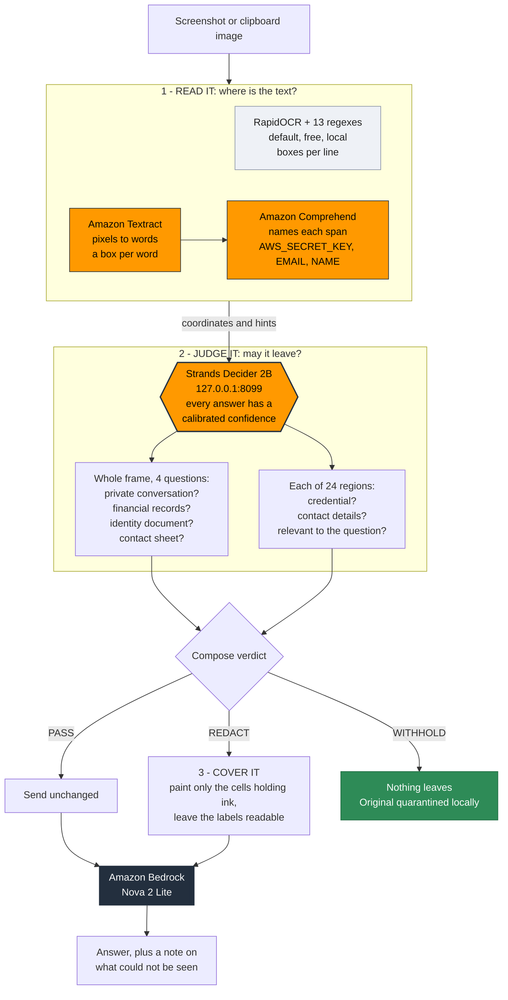

# SnapGuard

**Share a screenshot without sharing your secrets.**

Something has gone wrong, so you grab a screenshot and send it to a friend, drop it in
Slack, attach it to a ticket, or paste it into a chat assistant. The error you wanted to
show is in the terminal on the left. The access key sitting in the editor on the right
goes along for the ride.

SnapGuard puts a decision in between. **Strands Decider 2B** runs on your own machine,
looks at your screen region by region, and decides what may leave. The key gets covered.
Everything you actually meant to share stays readable.

```
56% of a screen covered  ->  1.2%, one box, on the line that holds the key
```

## When you would use it

**Sending an error to a colleague.** Run `snapguard guard`, take your screenshot, and
paste it anywhere — Slack, WhatsApp, Teams, email, a Jira ticket, a GitHub issue, a
Stack Overflow question. Your clipboard already holds the safe version by the time you
paste. It never has to know where the image is going.

**Asking a cloud model about your screen.** `snapguard ask` gives a Strands agent on
Amazon Bedrock only the regions that are both safe *and* relevant to your question — on
the demo screen, three regions of twenty-four.

**Pair programming, demos, live streams.** Arm it for an hour with `snapguard guard
--for 60` and every screenshot you take in that window is checked before it can be
pasted.

The common thread: the moment you paste is the moment a secret escapes, and that is the
moment this closes.

---

## What it does

Every region of your screen is scored on **two independent questions**:

- **Is it safe to send?** — credentials, private conversations, financial records,
  identity documents, people's contact details
- **Is it worth sending?** — does this region actually bear on what you asked?

Only regions that are **both** reach the cloud. That intersection is the decision, and
it is why most of a screen stays on your machine even when nothing on it is sensitive.

The gate has three possible answers, not two:

| verdict | what happens |
|---|---|
| **PASS** | the screenshot is clean, nothing changes |
| **REDACT** | the sensitive parts are painted over, the rest is sent |
| **WITHHOLD** | the whole screen stays local, and you are told why |

---

## Architecture

Two things happen to every capture: something **reads** it, and Decider **judges** it.
The reader is swappable. The judge is not.

```
                ┌──────────────────────────────────────────────┐
                │              YOUR MACHINE                    │
                │                                              │
 screenshot ───►│  1. READ IT  ── where is the text? ──────┐   │
 or clipboard   │                                          │   │
                │     default:  RapidOCR + 13 regexes      │   │
                │               free, stays local,         │   │
                │               boxes per LINE             │   │
                │                                          │   │
                │     --aws-lane:  ┌────────────────────┐  │   │
                │                  │ AMAZON TEXTRACT    │  │   │
                │                  │  pixels -> words,  │  │   │
                │                  │  a box per WORD    │  │   │
                │                  ├────────────────────┤  │   │
                │                  │ AMAZON COMPREHEND  │  │   │
                │                  │  names each span:  │  │   │
                │                  │  AWS_SECRET_KEY,   │  │   │
                │                  │  EMAIL, NAME, SSN  │  │   │
                │                  └────────────────────┘  │   │
                │                                          │   │
                │                 coordinates + hints ◄────┘   │
                │                          │                   │
                │  ┌───────────────────────▼────────────────┐  │
                │  │  2. JUDGE IT    STRANDS DECIDER 2B     │  │
                │  │                 127.0.0.1:8099         │  │
                │  │                                        │  │
                │  │   whole frame ──► 4 questions          │  │
                │  │   6x4 regions ──► 2 questions          │  │
                │  │                   + relevance          │  │
                │  │                                        │  │
                │  │   every answer carries a               │  │
                │  │   calibrated confidence                │  │
                │  └───────────────────────┬────────────────┘  │
                │              verdict per region              │
                │  ┌───────────────────────▼────────────────┐  │
                │  │  3. COVER IT                           │  │
                │  │     paint only the cells holding ink,  │  │
                │  │     leave the labels readable          │  │
                │  └───────────────────────┬────────────────┘  │
                └──────────────────────────┼───────────────────┘
                                           │
                              only cleared regions
                                           │
                       ┌───────────────────▼──────────────────┐
                       │          AMAZON BEDROCK              │
                       │     Nova 2 Lite reads them and       │
                       │     answers your question            │
                       └──────────────────────────────────────┘
```

**Why the split matters.** Textract and Comprehend answer *what is on screen and where*.
Neither can answer *may this leave the machine* — that is not a property of the text. On
the first capture it was tried on, Comprehend labelled "Madurai" an `ADDRESS` at 0.67,
because it was part of the phrase "AWS User Group Madurai". It names spans; Decider
decides.

### The same flow, as a diagram



The reader on the left is the default and never leaves your machine. The two AWS services
on the right are the `--aws-lane` alternative: they read small text the local engine
cannot and return a box per **word** rather than per line, which is what lets a heading
stay visible while the key beside it is covered. Either way the arrow out of the box is
the same — **Decider decides**.

---

## What we used

| | what it does here |
|---|---|
| **Strands Decider 2B** | makes every decision. Reads a region, answers a typed question, returns a score with a calibrated confidence. Runs locally on CPU |
| **Amazon Bedrock** (`us.amazon.nova-2-lite-v1:0`) | the generative half. Reads the cleared regions and answers the user's question |
| **Strands Agents SDK** | the agent, and its `InterventionHandler` seam where the gate sits |
| **Amazon Textract** *(optional)* | reads the screen into words with exact boxes, for word-precise redaction |
| **Amazon Comprehend** *(optional)* | names each span it finds — `AWS_SECRET_KEY`, `EMAIL`, `NAME` |
| **RapidOCR + 13 regex patterns** | the free local fast lane, for secrets with a known shape |
| **Pillow / NumPy** | the redaction itself, pixel arithmetic, no model needed |

**Decider makes the decision; everything else only reads or writes.** Four of the six
rules — *is this a private conversation, a bank page, an ID document, a list of people* —
are whole-screen judgements that no text extractor can answer.

---

## Results

Twelve labelled screens, same questions, same ground truth
([`evalset/bench.py`](evalset/bench.py)):

| System | Accuracy | Held-out only | Cost |
|---|---|---|---|
| **Strands Decider 2B (local, CPU)** | **12 / 12** | **6 / 6** | **$0.00** |
| Nova 2 Lite (Bedrock) | 10 / 12 | 4 / 6 | $0.00037 |
| Nova Pro (Bedrock) | 9 / 12 | 3 / 6 | $0.00927 |

On a CRM screen holding seven people's emails, phone numbers and home addresses, both
cloud models judged it safe to send. Decider withheld it — **100% kept local**.

**174 tests**, and the gate was verified end to end against Bedrock.

---

## The rules

Six questions, each about one concrete, visible thing. Thresholds derived from measured
separations.

| rule | scope | threshold | verdict |
|---|---|---|---|
| `credential` | per region | 0.35 | REDACT |
| `personal_contact` | per region | 0.60 | REDACT |
| `private_conversation` | whole frame | 0.55 | WITHHOLD |
| `identity_document` | whole frame | 0.55 | WITHHOLD |
| `financial_records` | whole frame | 0.70 | WITHHOLD |
| `contact_sheet` | whole frame | 0.70 | WITHHOLD |

Adapting it to your own definition of sensitive means editing one file:
[`snapguard/questions.py`](snapguard/questions.py).

---

## Run it, step by step

### 1. Requirements

- Python 3.10 or newer
- Windows for the clipboard watcher (`check` and `ask` work anywhere)
- An AWS account with Bedrock access, for the agent half

### 2. Create the environment and install

```powershell
python -m venv .venv
.\.venv\Scripts\Activate.ps1

pip install -e ".[agent,ocr,windows,dev]"
```

### 3. Get the decision model

```powershell
pip install strands-decider
```

### 4. Start Decider 2B locally

Leave this running in its own terminal. **`--vision` is required** — it is what lets the
model look at images.

```powershell
strands-decider serve StrandsAgents/strands-decider-2B-qwen3.5-v1-2610 --vision --device cpu --port 8099
```

First run downloads the weights. Confirm it is up:

```powershell
curl http://127.0.0.1:8099/health
```

You want `"vision": true` in the reply.

### 5. Configure AWS

```powershell
aws configure
```

Then enable **Nova 2 Lite** in the Bedrock console under *Model access*, in the region
you configured.

### 6. Check everything is wired up

```powershell
snapguard doctor
```

```
decider server
  ok    strands-decider-2B on cpu, vision on
OCR fast lane
  ok    installed
clipboard
  ok    Windows (pywin32, CF_DIB)
Amazon Bedrock
  ok    us.amazon.nova-2-lite-v1:0 reachable
```

### 7. Inspect a single image

```powershell
snapguard check evalset\out\deploy_failure.png
```

Add `--out safe.png` to write a redacted copy, or `--explain seen.png` to get an
annotated view showing every score the gate produced.

### 8. Run the agent

```powershell
snapguard ask "my deploy is failing, what's wrong?" --screen evalset\out\deploy_failure.png
```

```
THE GATE RAN
  credential=0.915 on tile 3  -> redact
  credential=0.776 on tile 9  -> redact
  regions: 3 of 24 sent, 4 withheld for safety,
           2 skipped as unrelated  (88% kept local)
  VERDICT: REDACT

WHAT THE AGENT SAID
  The deployment is failing due to a database connection pool timeout:
  PoolTimeout: could not acquire a connection within 5.0s

  Regions [3, 4, 9, 10] were withheld because they contained a credential.
  You should rotate it immediately.
```

The agent asked for the whole screen and was given three regions. It still solved the
problem, and said which parts it could not see.

### 9. Guard your clipboard

This is the one to use when you are sending a screenshot to a person.

```powershell
snapguard guard
```

Now take a screenshot with `Win+Shift+S` and paste it wherever you were going to —
Slack, WhatsApp, a ticket, an email. The image is held the instant it appears, inspected,
and a safe version is put back on your clipboard, so what you paste is already clean.

```
[16:32:58] image on clipboard, 1920x1080
[16:33:14] regex  aws_access_key_id (AKIA...(20 chars)) at (411, 134, 1016, 169)
[16:36:19] decider credential=0.758 on tile 1 -> redact
[16:36:19] mesh   kept 10% of the flagged area
[16:36:20] REDACTED  3 box(es), 2% of the frame
```

Useful flags:

| flag | effect |
|---|---|
| `--for 60` | disarm automatically after 60 minutes |
| `--folders` | watch screenshot folders instead of the clipboard |
| `--vault` | keep the original of every blocked capture in a local quarantine folder |
| `--aws-lane` | use Amazon Textract and Comprehend for word-precise boxes |
| `--mode blur` | blur instead of painting solid |

### 10. Run the tests

```powershell
python -m pytest tests -q
```

### 11. Reproduce the benchmark

The twelve evaluation screens are **generated, not photographed** — every one is drawn by
a script, so the benchmark is reproducible from source and the repository carries no
screenshots. Draw them first:

```powershell
python evalset\screens.py          # the six original screens
python evalset\hard_screens.py     # the six held-out screens
```

Then run the benchmark. `--skip-cloud` measures Decider alone; drop it to compare
against Nova 2 Lite and Nova Pro on Bedrock.

```powershell
python evalset\bench.py --skip-cloud
```

---

## Two flags worth understanding

**`--vault`** keeps the unredacted original of every blocked capture, so you do not lose
a screenshot the gate withheld. Those files are real secrets in plain PNG — list them
with `snapguard vault` and empty the folder with `snapguard vault --purge`.

**`--aws-lane`** sends the capture to Amazon Textract and Comprehend in your own AWS
account, which reads small text the local engine cannot and returns a box per word. It is
off by default; without it nothing leaves your machine. Either way, the **decision** is
always made locally by Decider.

---

## Project layout

```
snapguard/
  patterns/            THE REUSABLE ASSET - RegionGate + the Strands intervention
  questions.py         the rubric: typed questions and thresholds
  decider.py           client for the local Decider server
  tiling.py            cutting a frame into regions
  mesh.py              covering only the parts of a region that hold ink
  scanner.py           the local fast lane: OCR + regex
  aws_lane.py          the cloud lane: Textract + Comprehend
  redact.py            painting over what was withheld
  overlay.py           the annotated "what the gate saw" view
  watch.py             clipboard and screenshot-folder watching
  vault.py             local quarantine for blocked captures
  agent/               the Strands agent on Amazon Bedrock
  cli.py               check / ask / guard / vault / doctor

evalset/               12 labelled screens and the benchmark
research/              every measurement behind every number above
tests/                 174 tests
```

---

## The reusable pattern

[`snapguard/patterns/`](snapguard/patterns/README.md) — **`RegionGate`**, with no
dependency on the rest of this project.

Score the regions of an image against a written rubric, coarse to fine, and compose a
verdict in your own code:

```python
from snapguard.decider import Decider
from snapguard.patterns import RegionGate, Verdict

gate = RegionGate(Decider(), rules=MY_RULES)
result = gate.inspect(screenshot)

if result.verdict is Verdict.WITHHOLD:
    ...                                   # keep it local
elif result.verdict is Verdict.REDACT:
    send(redact(screenshot, result.boxes()))
else:
    send(screenshot)
```

Wiring it into a Strands agent uses the **`Transform`** action rather than allow/deny —
it *narrows* a tool call in place, so an agent that asked for twenty-four regions reads
the three that were clean and relevant, and never learns the others existed.

---

## License

Apache-2.0. See [LICENSE](LICENSE).

Built for the AWS **Agent Experience Hackathon: Strands Decider**.
`#strands-decider-2b` `#context-memory`
