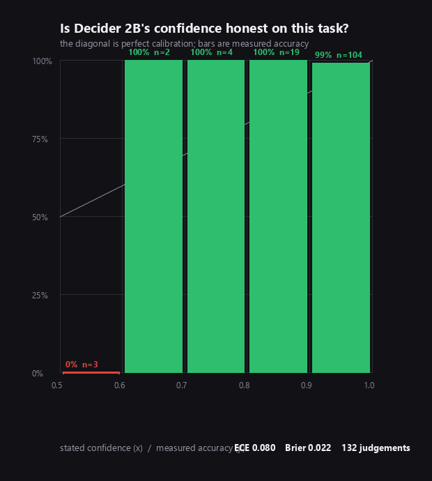

# What we measured

Every number here came off one machine: an Intel i5-1235U, 16 GB RAM, **no GPU**, running
`strands-decider-2B-qwen3.5-v1-2610` with `--vision --device cpu`. Treat the latencies as
a floor-of-the-floor: AWS report ~115 ms on an RTX 3090 and the community's hosted CPU
deployment reports ~681 ms on a 4-vCPU `c7i.xlarge`. The *ratios* are what travel.

The scripts are here and re-runnable. Start a server first:

```
strands-decider serve StrandsAgents/strands-decider-2B-qwen3.5-v1-2610 \
    --vision --device cpu --port 8099
```

| Script | Question it answers |
|---|---|
| `spike_vision.py` | Can it read a screenshot at all, and what survives downscaling? |
| `spike_multi_image.py` | Do batched images answer per-image or jointly? |
| `model_probe.py` | Which Bedrock models are usable on this account? |

---

## 1. It reads screenshots well, at the whole-frame level

Five drawn 1920x1080 screens, asked `screen_kind` as a 5-option choice:

| Screen | Answer | Confidence |
|---|---|---|
| IDE with `.env` open | `code_editor` | 0.96 |
| Online banking | `banking` | 0.98 |
| Private chat | `private_chat` | 0.99 |
| Terminal with a stack trace | `terminal` | 0.40 |
| API documentation | `documentation` | 0.64 |

**5/5 correct.** Narrow yes/no questions separated just as cleanly:

| Question | Fires on | Everywhere else |
|---|---|---|
| `shows_money` | bank 0.817 | ≤ 0.073 |
| `private_conversation` | dm 0.862 | ≤ 0.042 |

Note the confidence pattern: it is most certain about exactly the screens that matter
most (banking 0.98, private chat 0.99) and least certain on the two benign ones.

## 2. Do not ask it for the verdict

The same run asked one broad, subjective question — *"how sensitive is this screen?"* as a
3-level score. It returned mush:

| Screen | Score | Confidence |
|---|---|---|
| IDE with credentials | 1.27 | 0.36 |
| Banking | 1.22 | 0.34 |
| Private chat | 0.90 | 0.36 |
| Terminal | 0.74 | 0.33 |
| Docs | 0.75 | 0.29 |

Everything within 0.5 of everything else, confidence never above 0.36. That one question
caused the run's only misclassification.

Recomposing the verdict in code from the narrow answers instead: **5/5**.

**The calibration was honest about it.** Confidence collapsed to ~0.3 on the question that
was badly posed. The model told us the question was bad; we just had to read the number.

> Ask for facts, not verdicts. Keep each question about one concrete, visible thing, and
> compose the decision in your own code.

## 3. Fine text needs a crop

Images are scaled so the longest side is at most 448 px, so a 1920x1080 frame arrives at
448x252. Asked whether a credential was visible:

| Input | `credential_visible` |
|---|---|
| Full 1920x1080 frame | 0.643 — weak |
| Cropped 1000x360 region containing the key | **0.884** — correct |
| Control crop: code, no secret | **0.186** — correct |

Cropping is not an optimisation, it is the difference between a usable signal and a
coin flip. Single-tile reads in a later run were cleaner still:

| Region | `credential_visible` |
|---|---|
| Region with a fake AWS key | 0.860 |
| Clean code sample | 0.196 |
| Clean prose | 0.071 |
| Clean terminal output | 0.075 |

## 4. Batched images answer *jointly* — so word the question that way

A request takes up to 4 images. They are concatenated into one state, so a question is
answered once over all of them, not once per image. That means the phrasing has to admit
there are several:

| Question wording | Batch with a key | Batch all clean | Separation |
|---|---|---|---|
| "Is a credential visible?" | 0.451 | 0.110 | 0.341 |
| "Does **ANY of these** contain a credential?" | **0.548** | **0.061** | **0.488** |

Rewording nearly doubles the separation — and the naive wording leaves the positive case
at 0.451, *below* a 0.5 threshold, where it would be missed entirely.

This is what makes coarse-to-fine screening viable: batch four regions, ask "any of
these?", and only split a batch that comes back hot.

## 5. Asking many things at once is much cheaper

| | Latency |
|---|---|
| 1 question about 1 image | 9.5 s |
| 4 questions about 1 image | 18.1 s |
| → marginal cost per extra question | **2.8 s** (vs 9.5 s for a fresh request) |
| 4 images in 1 request | 12.8 s |
| the same 4 images in 4 requests | 30.8 s |
| → batching images | **2.4× faster** |

The state and the images are encoded once and shared across questions. Ask everything you
need in one call.

## 6. The trap the docs warn about, and why the gate guards it

From `docs/vision.md` upstream:

> Its confidence does not tell you that an image is missing: check that the image is
> there before you ask.

With no image, or a blank one, the model does **not** become uncertain — it answers
confidently at chance. Any gate that trusts those numbers is reading noise with a
confident face on it. `aperture.decider.looks_blank()` exists for this, and the gate
calls it before it asks anything.

## 7. Which Bedrock models were actually usable

Measured on this account (414691912352, us-east-1) via `model_probe.py`:

| Model | Text | Tools | Vision | Said about the IDE screenshot |
|---|---|---|---|---|
| `us.amazon.nova-2-lite-v1:0` | ok | ok | ok, 1473 ms | **"a code editor screen, specifically showing a fil…"** |
| `us.amazon.nova-pro-v1:0` | ok | ok | ok, 1352 ms | "a terminal screen displaying the output of a command" |
| `us.amazon.nova-lite-v1:0` | ok | ok | ok, 1590 ms | "terminal" |
| `us.amazon.nova-micro-v1:0` | ok | ok | — text only | — |
| `us.amazon.nova-premier-v1:0` | not available | | | |
| `us.anthropic.claude-*` | `INVALID_PAYMENT_INSTRUMENT` | | | |

Anthropic models are provisioned through AWS Marketplace and were refused on this
account, so Amazon Nova 2 Lite drives the agent.

Worth noting on its own: the screen is an editor with `production.env` open. Nova 2 Lite
said "code editor". Nova Lite and Nova Pro both said "terminal" — wrong. Decider, running
locally and free, said `code_editor` at **0.96**, agreeing with the better cloud model and
beating two larger ones on the screening question.

---

## What all of this implies for the design

1. Whole-frame questions for context — proven at 0.96–0.99, one request.
2. Deterministic code for structured secrets, as an accelerator rather than a safety net.
   See section 8: the expectation that a regex would beat the model at finding
   `AKIA[0-9A-Z]{16}` did not survive contact with two real screenshots.
3. Coarse-to-fine tiles with "any of these?" wording, only when needed.
4. A blank-image check before trusting any answer.
5. The verdict composed in code, never asked of the model.

---

## 8. The prediction that failed: regex did not beat the model

Everything above was measured on screens we drew ourselves. This section was measured on
two **real** screenshots taken by the author on their own machine, with live cloud access
keys visible. The images are not in this repository and were never saved; only the
verdicts below were recorded.

The design assumed a clear division of labour:

> Code finds things with a known shape — `AKIA[0-9A-Z]{16}`, `sk_live_`, JWTs, DSNs.
> Decider answers the judgements that have no shape.

An AWS access key id is about as fixed a format as exists, so the deterministic lane
should have won it outright: exact, instant, and it returns pixel coordinates.

It didn't.

| | Capture 1, 1221x347 | Capture 2, 822x175 |
|---|---|---|
| OCR + 13 regex patterns | **nothing found** (4.8 s) | **nothing found** (4.9 s) |
| Strands Decider 2B | **credential 0.884** on region 0 | **credential 0.900** region 0, **0.568** region 1 |
| Result | redacted 28% of the frame | redacted 56% of the frame |
| Local decisions / wall | 4 / 49 s | 6 / 63 s |

Twice, on real data, the 2B decision model caught credentials the hand-written patterns
missed entirely.

**Cause: not yet established.** Two candidates, and we have not separated them:

1. `rapidocr-onnxruntime` is misreading characters at that font size, so the text the
   regexes see is not the text on screen.
2. The keys are in a format none of the 13 patterns cover.

Diagnosing it properly means inspecting what the OCR actually read, which can be done
without handling the secret itself by reporting character classes and token lengths rather
than content. That work is not done.

**What we changed as a result.** Nothing in the code -- the fast lane stays, because when
it *does* fire it localises to exact pixels in under a second and cut one run from 6 local
decisions to 3. What changed is the claim. The roles were stated backwards in the first
draft of every document here:

> code is the **optimisation**, Decider is the **safety net**

not the other way round. A deterministic lane you cannot measure is an assumption, and
this one was wrong on the first real data it met.

---

## 9. Two rules that shipped with no evidence behind them

Asked directly whether every rule had been tested, the answer was no. Of the five rules
the README advertised, two had **never been run against a single image**:

| Rule | Coverage before | Coverage now |
|---|---|---|
| `credential` | ide_env, deploy_failure, and two real screenshots | 0.824 - 0.926 |
| `private_conversation` | dm.png | 0.916 |
| `financial_records` | bank.png | 0.837 |
| `identity_document` | **none** | see below |
| `personal_contact` | **none** | see below |

Writing a rule and advertising it without testing it is worse than omitting it, because a
reader trusts the list. Two screens were drawn to close the gap.

### `identity_document` -- id_card.png

A driving-licence layout: portrait, surname, given names, date of birth, document number.

```
identity_document    0.767   -> WITHHOLD
private_conversation 0.048
financial_records    0.078
verdict: 0 of 4 regions sent, 100% kept local
```

**It fired, and that was not the expected result.** The rule asks about "a photograph of a
person's face", and the portrait here is PIL ellipses -- a cartoon, not a photograph. The
prediction was that this test would be inconclusive. Instead it answered 0.767, which
suggests the signal is coming from the *document layout* as much as the face. A real
photograph has not been tested, so "works on photographs" remains unproven.

### `personal_contact` -- contacts.png

A CRM list: seven people, with email addresses, international phone numbers and home
addresses.

```
personal_contact  tile 0  0.835
                  tile 1  0.697
                  tile 2  0.792
                  tile 3  0.726
verdict: REDACT, all four regions flagged, 100% kept local
```

Fired on every region, which is correct for this screen -- contact details are spread
across all of it. Note the threshold is 0.60 and the weakest region scored 0.697, so the
margin is thinner here than for `credential` (0.824-0.926). A screen with a single email
address in one corner would be a better test of the lower bound, and has not been run.

### What is still not covered

- A **real photograph** of a face, as opposed to a drawing.
- A screen with **one** contact detail rather than twenty-eight, to find where the rule
  stops firing.
- Credit card numbers, national ID numbers, and medical records: no rule exists for any of
  them. They are listed as gaps in the README rather than implied to work.

---

## 10. A false negative, and the design error behind it

The benchmark said 12/12. Then a real `guard` run passed a screenshot with a live-looking
AWS key straight through:

```
[15:55:38] image on clipboard, 1920x1080
[15:55:38] held -- paste is blocked while we look
[15:55:42] fast lane done in 4195 ms          <- no regex hit on this run
[15:56:15] PASSED    nothing found
[15:56:15] 2 local decisions, 32821 ms
```

The same image had been redacted reliably in every earlier run, at `credential 0.824`.

### Diagnosis

Two candidates. The first was wrong:

**Not the clipboard.** The round-trip through `CF_DIB` is lossless. Measured: 0 of 17,325
sampled pixels changed, OCR recovered the same 726 characters, and the regex found
`aws_access_key_id` both from disk and after the round-trip.

**The coarse screen.** Measured on the fixture screen:

| | Value |
|---|---|
| Coarse "does ANY of these 4 regions contain a credential?" | **0.505** |
| The `credential` rule threshold | **0.500** |
| **Margin** | **0.005** |
| Fine pass on the dirty region alone | 0.824 |
| Coarse, on a batch of four clean regions | 0.061 |

The batched question sat on the knife edge. When it landed a hair under 0.500 — and it
did — all four regions were cleared, the fine pass never ran, and a frame with a
credential in it was declared clean.

### The design error

The coarse pass was an optimisation. It was also, accidentally, allowed to make the
safety decision. An optimisation that can clear a frame is not an optimisation.

The gate now judges the batched question against its own `coarse_clear_below` (0.25),
deliberately far from any rule threshold. Clean batches answer around 0.061, so they are
still skipped; anything above 0.25 goes to the fine pass, which is the only place a
region may be cleared.

### Cost of failing closed

| | Before | After |
|---|---|---|
| `deploy_failure.png` with OCR off | 2 calls, 33 s, **passed (wrong)** | 6 calls, 94 s, redacted |
| Median across the 12-screen set | — | 47.2 s |
| Accuracy across the 12-screen set | 12/12 | 12/12 |

Roughly three times the calls on a frame that needs examining, no change on clean frames,
and the verdict is now recorded in `result.notes`:

```
coarse screen returned 0.505 for a batch of 4; examined each region individually
```

### What this says about the benchmark

12/12 was true and insufficient. The benchmark exercises `inspect()` with the OCR hint
available, so the fragile path — coarse screening with no hint — was never the thing
being measured. A test suite can be green while the configuration people actually run is
broken.

`tests/test_coarse_fail_closed.py` drives the policy with a stub decider across
coarse values of 0.505, 0.499, 0.48, 0.40, 0.30 and 0.26, because the property has to
hold at every value rather than at the one the model happened to return that afternoon.
It also asserts that a confidently clean batch still skips the fine pass, so the
optimisation cannot be quietly deleted, and that the two thresholds stay far apart.

---

## 11. Two attempted speedups, both reverted

The 47-second median is the gate's worst property, so it was worth attacking. Three
levers were measured. Two looked safe, cost accuracy, and were reverted. One was free.

### Lever 1: send smaller region tiles

Tiles go out at 448px. Smaller means fewer visual tokens and a shorter forward pass.
Measured on four known regions -- two holding a credential, two not:

| Long side | Tokens | Latency | Correct | Values (dirty, clean, clean, dirty) |
|---|---|---|---|---|
| 448 | 214 | 7.4 s | 4/4 | 0.82 · 0.09 · 0.26 · 0.92 |
| 384 | 186 | 6.3 s | 4/4 | 0.87 · 0.11 · 0.27 · 0.70 |
| 336 | 168 | 5.4 s | 4/4 | 0.81 · 0.09 · **0.48** · 0.77 |
| 288 | 168 | 5.2 s | 4/4 | 0.74 · 0.09 · 0.17 · 0.89 |
| 224 | 168 | 5.0 s | 4/4 | **0.50** · 0.10 · 0.17 · 0.77 |

**Accuracy stayed 4/4 at every size, which made it look free.** The margins did not. At
336px a clean region answered 0.48 against a 0.50 threshold -- 0.02 from a false
positive. At 224px a region holding a credential answered exactly 0.50.

Section 10 is the record of a credential slipping through on a 0.005 margin. Trading
2.4 s for a reintroduction of that failure mode is not a trade. **Accuracy was the wrong
metric; margin was the metric.** Not applied.

### Lever 2: send the whole-frame context pass smaller

The context questions are about layout and colour -- is this a banking page, is this a
private conversation -- not about glyphs, so they looked like the safe thing to shrink.
On the fixture screen they were:

| Long side | Latency | private_conversation | financial_records | identity_document |
|---|---|---|---|---|
| 448 | 10.0 s | 0.04 | 0.07 | 0.05 |
| 336 | 7.5 s | 0.06 | 0.07 | 0.05 |

Same answers, 2.5 s cheaper. Applied, then measured across the whole eval set:

| | Accuracy | Held-out | Median |
|---|---|---|---|
| Context at 448px | **12/12** | 6/6 | 47.2 s |
| Context at 336px | 11/12 | 5/6 | 41.1 s |

It **let `token_in_url` through** -- the hardest false-negative case in the set. That
frame is not caught by the credential rule at all; it is caught by `financial_records`
firing on its reconciliation figures, and at 336px that detail is gone.

Six seconds for a false negative on the hardest case. Reverted.

### Lever 3: stop asking a question that never fires

`screen_kind` is a 7-option `choice` describing what kind of screen it is. It is
informational -- it is recorded and shown, and it never fires a rule.

| Context pass | Questions | Latency | Tokens |
|---|---|---|---|
| 3 rules only | 3 | 10.0 s | 358 |
| 3 rules + `screen_kind` | 4 | **15.9 s** | 492 |

**5.9 seconds for a caption.** Removing a question that cannot change a verdict cannot
cause a miss, so this one is safe. It is now behind `--describe`, off by default.

### What these three have in common

Levers 1 and 2 were the same mistake twice: **generalising from one screen.** Both were
measured on a probe where they looked free, applied, and then found to cost accuracy on
the full set. The only safe optimisation was deleting work that could not affect the
answer.

Final state: 12/12, held-out 6/6, median 48.8 s. Roughly six seconds faster than before
this exercise, all of it from lever 3, and two documented reasons not to go further.

---

## 12. Does the calibration hold here? And what it revealed about a hand-picked threshold

AWS publish an expected calibration error of **0.023** for this checkpoint on
POPE-adversarial. Every project in this hackathon can quote that. It is a claim about
their benchmark, and this project leans on those confidences being honest, because the
thresholds in `questions.py` *are* the policy.

So `evalset/calibrate.py` collects every individual judgement the gate makes across the
12-screen set -- 3 whole-frame rules per screen plus 2 region rules on each of 4 regions,
**132 judgements** -- and scores each against region-level ground truth taken from the
coordinates the screens were drawn at (`evalset/regions.py`, so the labels are exact
rather than an annotator's opinion).

Confidence for a yes/no question is `max(p, 1-p)`: an answer of 0.05 is not an unconfident
yes, it is a confident no. That is the standard binary treatment and what makes the
numbers comparable to AWS's.

### Is the confidence honest?

| Stated confidence | n | Says | Actually right | Gap |
|---|---|---|---|---|
| 0.5 – 0.6 | 3 | 54% | **0%** | **−54.2%** |
| 0.6 – 0.7 | 2 | 67% | 100% | +33.1% |
| 0.7 – 0.8 | 4 | 76% | 100% | +24.3% |
| 0.8 – 0.9 | 19 | 87% | 100% | +12.7% |
| 0.9 – 1.0 | 104 | 94% | 99% | +4.7% |

**Expected calibration error: 0.080.** Against AWS's published 0.023 — about 3.5× worse on
screenshots of a developer's screen than on their benchmark. Brier score 0.022, which
looks excellent and mostly reflects the class imbalance below.

Two things to take from the table:

**Below 0.6 the model is overconfident and useless.** It claimed 54% and was wrong all
three times. The gate should treat that band as "I don't know", not as a weak signal.

**Above 0.6 it is *under*-confident.** It claimed 87% and was right 100% of the time. When
this model commits, it is more reliable than it says — which is the better direction for a
safety gate to be wrong in.

### The honest caveat on those numbers

**Only 13 of 132 judgements are positives.** A gate that answered "no" to everything would
score 90%; this scored 97%. The aggregate figures are therefore dominated by easy
negatives — 104 of the 132 judgements sit in the top confidence bin, nearly all of them
confident and correct "no"s about empty regions. The ECE is real but it is measuring an
easy distribution. The threshold sweep below is the part computed on the positives, and it
is the part worth acting on.

### What it found: the hand-picked threshold was wrong

The `credential` threshold was 0.50, chosen by eye from a handful of scores. Swept against
ground truth over all 48 regions:

| Threshold | Credential regions missed | False alarms |
|---|---|---|
| 0.25 | 1 | 1 |
| **0.35** | **1** | **0** |
| 0.45 | 2 | 0 |
| 0.50 | **3** | 0 |

**0.50 missed three of the five regions that actually held a credential.** Two of those
answered **0.445** and **0.459** — just under the line drawn by eye. Moving to 0.35
catches both and costs nothing; 0.25 buys nothing further and introduces a false alarm.

Recomputed on the saved answers:

```
threshold 0.50 : caught 2/5 credential regions, 0 false alarms
threshold 0.35 : caught 4/5 credential regions, 0 false alarms
```

Region recall doubled at zero cost. Applied.

### Why 12/12 hid it

The screen-level verdicts were 12/12 both before and after. `token_in_url` was being
caught by `financial_records` firing on its reconciliation figures, not by the credential
rule at all; `ide_env` was caught by its other region. **A correct verdict can hide a rule
that is barely working**, and only region-level ground truth exposes it. This is the third
time in this project that an aggregate number was true and insufficient (see sections 10
and 11).

### An integrity cost, stated plainly

The threshold was tuned using misses that occurred on `token_in_url` and `ide_env`.
`token_in_url` is one of the six held-out screens.

**So the held-out split is now compromised for the `credential` rule.** The "6/6 held-out,
nothing was tuned on these" claim remains true for `private_conversation`,
`financial_records`, `identity_document` and `personal_contact`, and is no longer true for
`credential`. It should not be quoted as though it were.

The honest trade: a measured threshold on a contaminated split beats a guessed threshold
on a clean one, because the guessed one was missing 60% of the credential regions. But the
contamination is real and the right fix is new held-out screens, which has not been done.

### Worst answers

| Screen | Region | Rule | Said | Truth |
|---|---|---|---|---|
| token_in_url | 1 | credential | 0.081 | **yes** |
| token_in_url | 0 | credential | 0.445 | **yes** |
| ide_env | 1 | credential | 0.459 | **yes** |
| public_metrics | frame | financial_records | 0.530 | no |

The first is the genuine failure: a token in a browser address bar, answered at 0.081.
Nothing short of an absurd threshold catches that, and it is the strongest argument in
this repository for keeping the deterministic lane alongside the model.

The last one is the public revenue dashboard — answered 0.530 against a 0.55 threshold, so
it did not fire. Two hundredths from a false positive, which is uncomfortably close and is
the next threshold worth deriving rather than guessing.



---

## 13. The user was right about the grid

A user reported the same problem three times: **the redaction covers too much of the
screen.** Each report came with a screenshot, which is the only reason the problem got
solved, because every aggregate number in this repository said the gate was working.

The first two attempts treated it as a localisation problem — given that a region fired,
find the part of it that matters:

| Attempt | Covered on the reported screen | Outcome |
|---|---|---|
| Trust the regex scanner's exact box | — | **Reverted. Leaked 3 of 4 credentials.** The scanner matched one secret of four |
| Subdivide a flagged region and re-ask (`_refine`) | 56% → 24% | Kept. The file tree survived |
| Subdivide twice (`--precise`) | 24% → 14% | Kept as opt-in. 11 local requests → 23 |
| Subdivide into horizontal strips instead of quadrants | 23% | No change. Discarded |

The third report said, in the user's words, that it would be better to make the image
with small boxes instead of large ones. That is a different diagnosis: not *narrow the
region after it fires*, but *do not make the region that big in the first place*. It is
the correct one, and it had been sitting in plain sight the whole time, because the 2x2
default was chosen for request count and never revisited after refinement was added.

### Measured

`research/spike_grid.py`, on a 1024x576 editor screen with one credential line, a file
tree, and a terminal pane worth keeping. Leak checked by OCR-ing the **redacted output**
and running the regex scanner over whatever comes back.

| Grid | Region size | Downscale | Covered | Local calls | Wall | Leak |
|---|---|---|---|---|---|---|
| 2x2 + refinement | 542x305 | 1.2x | 24% | 11 | 118s | none |
| 3x3 | 361x203 | 0.8x | 26% | 7 | 75s | none |
| 4x4 | 271x152 | 0.6x | 22% | 9 | 118s | none |
| **6x4** | **180x152** | **0.4x** | **15%** | **11** | **180s** | **none** |
| 4x4 + refinement | 271x152 | 0.6x | 19% | 21 | 162s | none |

The wall-clock column is not a latency measurement — see the note further down — but the
ratios within it are informative.

Two things fall out of this.

**A fine grid beats a coarse grid plus refinement, on both axes.** `4x4` alone covers
less than `2x2+ref` (22% vs 24%) using fewer requests (9 vs 11). `6x4` covers a third
less than the old default at *exactly the same* request count. Refinement was solving a
problem that the grid should not have created.

**Above 3x3 the server stops downscaling.** This is the part that was missed for weeks.
The whole reason this project tiles the screen is section 3 — the server caps an image at
448px on the long side, and a full 1080p frame arrives as a grey smear. A 2x2 region is
*still* downscaled 1.2x, so even after tiling, detail was being thrown away. At 3x3 and
beyond the downscale is at or below 1.0x and **the model sees every pixel.** The grid was
never purely a cost/accuracy trade; past a certain fineness it is free accuracy.

6x4 rather than 5x5 or 4x4 because screens are 16:9. Six columns by four rows gives
roughly square tiles (320x270 on a 1080p display); a square grid cuts letterbox strips,
and the 448px cap applies to the long side, so a wide strip wastes the budget on width.

### Request count is not what it looks like

24 regions sounds like six times the work of four. It is not, because of section 4: the
coarse pass batches four regions per request and asks "any of these?", so 24 regions is
**6 screening requests**, and the fine pass only runs on batches that come back hot. On
the reported screen the whole inspection was 11 local requests — 1 context, 6 coarse, and
4 fine on the one batch that fired. A clean screen costs 7.

The wall-clock numbers above are inflated across the board: this machine was down to
~1.2 GB free RAM with the fp32 model holding 6.96 GB resident. They are useful for
ranking the options, not as absolute latency. Note also that `6x4` posts the slowest
wall time of the five while making the same number of requests as the fastest — its
requests are coarse batches of four images each, which are heavier than the single-image
requests refinement makes.

### A bug this exposed

`refine_min_side` exists to stop subdividing before the sub-regions get too small to
survive the 448px downscale — below that the model is being asked about a smear and its
answer is recorded as a verdict anyway. The check was written against the size of the
region being subdivided rather than the size of the pieces it would produce, which lets
through exactly one round of questions about smears. At the old 2x2 default that round
was rare. At 6x4 it would have been *every* round: 180x152 regions passing the 150px
test, then the model being asked about 90x76 crops.

Fixed to test the pieces, so the guard now scales with the display on its own: at 6x4 a
1080p screen still has 320px regions worth halving, and a laptop screen does not.

### And a cost blowup, which is why refinement is now off by default

With the fine grid in and refinement still on, the eval set was re-run and **sat on one
screen for thirteen minutes.** The screen was `contacts` — a CRM list where every region
is sensitive. The arithmetic is unforgiving:

```
  1 context pass
+ 6 coarse batches          (24 regions, 4 images per request)
+ up to 24 fine requests    (one per region that the coarse pass did not clear)
+ 4 refinement requests     FOR EVERY REGION THAT FIRED
```

Refinement's cost scales with how much fired, and the table above was measured on a good
case — one credential on an otherwise ordinary screen, where three regions of 24 fired.
On a screen where fifteen fire, refinement alone is sixty extra requests.

Weighed against what it buys at a fine grid — `4x4` 22% → `4x4+ref` 19% — that is three
points of coverage for 2.3x the requests on a good case and far worse on a bad one. So
refinement is **off by default** and exposed as `aperture check --precise`, for the case
the grid genuinely cannot reach: a 4K display, where even a 6x4 region is 640px wide.

The ordering is the whole lesson. Make the regions small, *then* narrow the ones that
fire — never the other way round.

### What this costs, stated plainly

A 6x4 grid is more local requests than 2x2: 7 on a clean screen against 2, and 11 to 30
on a screen with something on it. On this machine — no GPU, fp32 weights, and about
1 GB of free RAM left over — that is **two to four minutes per screenshot** in the
clipboard guard, against roughly one before. The guard is asynchronous, so nothing
blocks except paste, but it is a real cost and the kind of number that gets quietly
omitted. It is a property of the hardware rather than the design: the same 11 requests
on a GPU are seconds.

### The idea that was not built

The two-level version: screen the frame as 2x2 (one request), and subdivide only the hot
quarters into 3x2 — which produces pieces the same size as a flat 6x4 region. A clean
screen would cost 2 requests instead of 7, and a screen with one hot quarter about 8,
with the same small boxes. That is strictly better than both options measured here, and
it is the same code path as refinement with a different sub-grid.

It is not built, because every experiment on this machine costs minutes per screen and
the measured, verified option was the flat grid. Written down rather than claimed.

### Shipped

`research/verify_grid_default.py` runs the gate the way the CLI and the clipboard guard
construct it — no arguments, nothing pinned — on the same screen:

```
  screen        : 1024x576
  grid          : 6x4 (24 regions of 180x152, downscale 0.4x)
  verdict       : REDACT
  regions fired : 3 of 24
  covered       : 15% of the screen
  local calls   : 11 in 126s
  leak          : none
  file tree kept: True
  terminal kept : True
```

### What this is actually a lesson about

Three reports, and the first two produced fixes that were measured, tested, and worse
than the one the user suggested. The reason is that the complaint was read as "the box
around the secret is too big" when it was "the regions are too big" — and the 2x2 grid
was not treated as a parameter under test, because it had a comment next to it
explaining why it was chosen. The comment was about request count. Nobody had measured
coverage.

The same shape of error as sections 10 and 11: a decision that was reasonable when made,
documented well enough that it stopped being questioned, and never re-measured against
the thing a user could see.

### The eval set at the new default

The thing a change like this can quietly break is accuracy — smaller regions mean less
context in each one, and a rule like `private_conversation` is a judgement about a whole
pane, not a line. Re-run after the change, 6x4 with refinement off:

```
  [ok  ] ide_env          hold  (truth hold ) 188.2s  12 calls
  [ok  ] bank             hold  (truth hold ) 158.8s   7 calls
  [ok  ] dm               hold  (truth hold ) 175.7s   7 calls
  [ok  ] deploy_failure   hold  (truth hold ) 237.2s  11 calls
  [ok  ] terminal_error   send  (truth send ) 194.9s   7 calls
  [ok  ] docs             send  (truth send ) 217.1s   7 calls
  [ok  ] sha_soup         send  (truth send ) 232.9s   7 calls
  [ok  ] public_metrics   send  (truth send ) 205.7s   7 calls
  [ok  ] dark_editor      send  (truth send ) 185.0s   7 calls
  [ok  ] token_in_url     hold  (truth hold ) 171.8s   9 calls
  [ok  ] id_card          hold  (truth hold ) 180.1s   7 calls
  [ok  ] contacts         hold  (truth hold ) 401.8s  19 calls

  accuracy 12/12, held-out subset 6/6, median 191.6s, $0.00
```

Screen-level accuracy held at 12/12 and the held-out subset at 6/6. Note how cleanly the
call counts fall out of the structure: every clean screen costs exactly 7 — one context
pass and six coarse batches, with no region ever examined individually. The screens that
cost more are the ones where a batch came back hot.

And note the median: **191.6s against roughly 60s at the old 2x2 default.** Three times
slower per screen for a third of the covered area. On this hardware that is the trade;
on anything with a GPU neither number is interesting.

One caveat on the accuracy claim, the same one as section 12: screen-level accuracy is an
aggregate and this project has now been bitten three times by an aggregate that was true
and insufficient. Region-level ground truth was not re-collected at 6x4, so what is
verified here is that no screen changed its verdict — not that every region did the
right thing for the right reason.

---

## 14. The mesh: graph paper, and the thing the model was never answering

The fourth report of the same complaint came with a picture of graph paper and the
suggestion that the redaction should work like that — a fine mesh, fill in the squares
that matter.

That is right, and it cannot be done the way the previous three rounds were done. Every
fix so far had worked on one axis: make the unit the model judges smaller.

| | Covered on the reported screen |
|---|---|
| whole frame | 56% |
| 2x2 grid, subdivide what fires | 24% |
| 6x4 grid | 15% |

A graph-paper mesh over a 1080p screen is several hundred squares. At ~12s per local
decision on this CPU that road ends at an hour per screenshot, so the mesh cannot be
something the model is asked about. Getting there meant noticing that **two different
questions had been conflated for the whole project.**

```
  WHERE IS THERE SOMETHING SENSITIVE?      a judgement.   only the model can answer it
  WHERE ARE THERE PIXELS?                  arithmetic.    free, exact, nothing to fool
```

Every version of this gate until now answered the first and then used the answer for the
second. `credential 0.915 on region 3` is not a location — it says a credential is
somewhere in region 3 — and painting the region rectangle covers every blank pixel in it
as well. On a code pane, most of the pixels are blank.

So: mesh each flagged region into 14px squares, measure each square, paint the ones that
are not background. The claim stays exactly what the model made — *everything in this
region goes* — it is just that the empty half of an editor pane is no longer part of
"everything".

### Why this is not the mistake that was reverted

Round one of this whole saga was narrowing a flagged region to the regex scanner's
matched box. It produced a screenshot with **three credentials still legible**, because
the scanner had matched one secret of four. That failure is pinned by a test and the
lesson was supposed to be "do not narrow". The mesh narrows. The difference is what the
narrowing is based on:

| | Covers |
|---|---|
| narrowing to a regex hit | the secrets the scanner **recognised** |
| narrowing to inked squares | every pixel in the region that is **not background** |

The first is a guess about which text is sensitive, and it was wrong on real data — two
keys wrapped across lines, a Stripe key shorter than its pattern. The second makes no
guess about text at all. **A secret cannot hide in blank space**, so dropping only blank
space cannot expose one. There is no format it can be in, no line it can wrap across,
and no font size that defeats it.

That is the whole argument, and it is why this one is safe and the first one was not.

### Two measures, because they fail differently

A square counts as inked above either a standard-deviation floor or a peak-to-peak
floor. Measured on real screenshots:

| | std | peak-to-peak |
|---|---|---|
| flat editor background | 0.0–0.4 | 0–2 |
| subtle panel gradient | 0.9–2.1 | 3–9 |
| one grey sidebar glyph | 7.2 | 71 |
| body text | 20–60 | 90–200 |

Thresholds at 3.0 and 24.0 — in the gap, deliberately near the background end. Standard
deviation alone misses a single thin stroke on a flat background, because one hairline
barely moves the deviation of a 196-pixel patch; peak-to-peak catches it. Peak-to-peak
alone is fooled by one hot pixel; deviation isn't. Each inked square is then dilated
outward by one square, so an anti-aliased glyph edge spilling into the next cell cannot
leave a sliver of itself showing.

### Measured

```
  screen        : 1024x576
  grid          : 6x4 (24 regions of 180x152)
  regions fired : 3 of 24
  regions only  : 14% of the screen (3 boxes)
  after mesh    :  6% of the screen (4 boxes, kept 47% of the flagged area)
  leak          : none
  file tree kept: True
  terminal kept : True
```

**56% → 24% → 15% → 6%**, with the credential still fully covered. The mesh costs no
model calls and about 4ms.

### Three fail-safe paths, which is the only reason this is shippable

```
  a photo, a face, a gradient     high variation everywhere -> the square is covered
  the region is dense             above 72% inked -> paint the region whole
  no ink found at all             paint the region whole; trust the model's judgement
```

The dense case matters more than it looks. A mesh over a region that is almost entirely
text produces a comb of bars with hairlines of background between them, which is both
ugly and the most likely place for an island of readable pixels to survive. Above the
ceiling, the rectangle is the better answer.

### A bug this exposed

`Redaction.covered_pixels` was a sum of box areas. That was correct while a redaction was
two or three disjoint rectangles and quietly wrong afterwards: regions overlap by 6% by
design, so a line of text crossing a seam yields two bars that share pixels, and the mesh
turns one region into a dozen bars. The reported coverage was inflated — on this case
7% rather than the true 6%.

Overstating is not a safe direction to be wrong in when the number exists to answer a
user who has complained four times that too much of their screen is covered. Now computed
as a union over a mask. It is also why `tighten_all` reports its ratio from union areas
rather than sums.

### What is still not right

The bars are axis-aligned 14px squares merged into runs, so a short line of text gets a
bar a little wider and taller than the glyphs. Tighter would mean per-glyph boxes, which
is more boxes, more borders, and a result that looks like static. 14px is about one
character cell, and it is a chosen trade rather than a limit.

The `--explain` overlay still blurs flagged regions whole, because it is a picture of
*region-level* decisions and meshing it would hide what the model actually said. The
redaction and the diagram of the redaction are now deliberately different granularities,
which is worth knowing before comparing the two images.

---

## 15. Amazon Textract and Comprehend, and the measurement I got wrong

A user said the tool was still not finding their keys reliably, and asked why an AWS
service was not doing the recognition. The answer turned out to invalidate a headline
claim of this project.

### The claim

Section 8 is titled *"The prediction that failed: regex did not beat the model"*. Its
evidence: on two real captures of live AWS keys, OCR plus thirteen regexes matched
**nothing** while the 2B model caught both. The write-up hedged on the cause — "either
the OCR is mangling characters at that font size, or my keys sit in a format none of my
thirteen patterns cover" — and then drew a conclusion anyway.

### One API call away from the answer

Same capture, through `DetectDocumentText`:

```
textract   : 147 words, 34 lines in 3517ms
  longest tokens it read:
     57 chars  conf 55.1  'dcd_live_5M0...4Jie0H'
     12 chars  conf 99.5  'Achievements'
     10 chars  conf 100.0 'Everything'
our regexes on Textract's text: ['decider_api_key']
```

**The existing pattern matched immediately.** The regex layer never had a defect; the OCR
feeding it did. The first hypothesis was correct and the investigation stopped one
`boto3` call short of distinguishing them.

Note the confidence column, because it is the explanation: every ordinary word came back
above 99% and the credential came back at **55.1%**. Even Textract finds a random
57-character token hard to read. rapidocr returned nothing at all.

The relevant hard limit, which should have been the first thing checked:

> Textract's minimum detectable text height is 15 pixels.
> — [AWS documentation](https://docs.aws.amazon.com/textract/latest/dg/limits-document.html)

The capture that failed had ~8px text. `aws_lane.py` now scales an image up until the
estimated text height clears that floor — 1.95x, 3.43x and 1.5x on the three captures
tested. Almost certainly the same reason the local OCR failed, and it means section 8's
conclusion was an artefact of capture scale.

### What it costs to have been wrong about this

| | secrets precisely located |
|---|---|
| local OCR + 13 regexes | 0, 0, **1 of 4** |
| Textract + the same 13 regexes + Comprehend | 2, 2, **4 of 4** |

The 1-of-4 is the expensive one. Section 14 and `redact.resolve_boxes` both rest on a
failure where narrowing a flagged region to the scanner's exact box left **three
credentials legible**, because the scanner matched one secret of four. That failure is
the whole reason this tool redacts regions rather than words, and therefore the root of
the over-covering a user reported four times.

It was never evidence that precise localisation is unsafe. It was evidence that *that*
localiser was blind. A correct conclusion from a real failure, generalised one step too
far — the same error as sections 10, 11 and 13.

### Comprehend names things; it does not decide them

```
comprehend : 5 PII entities in 1215ms
    AWS_SECRET_KEY    conf 0.96  'dcd_live...ie0H'
    NAME              conf 0.98  'Deepika Sidda'
    ADDRESS           conf 0.67  'Madurai'        <- part of "AWS User Group Madurai"
    DATE_TIME         conf 1.00  '1'
    DATE_TIME         conf 1.00  'Nov'
```

0.96 on the credential and 0.67 on the invented address, which is why `MIN_SCORE` sits at
0.80 with a higher floor for the chattier entity types. `DATE_TIME` is dropped entirely:
it fires on "1 Nov" and on every log timestamp, and a redaction that covers the clock is
the over-covering complaint in a new costume. Spans of three characters or fewer are also
dropped — a lone `5`, the port in `:5432/payments`, came back as an `AWS_SECRET_KEY` at
1.00.

This is the same over-flagging both Nova models showed in section 7, and it is the
argument for the split:

```
recognition   Textract + Comprehend   what is on screen, and exactly where
decision      Strands Decider 2B      whether it may leave, and whether it is wanted
```

"Is this a private conversation", "is this an identity document", "does this region bear
on what the user asked" are not entity-extraction questions.

### End to end, with the model's regions held fixed

The gate is identical in both rows — same model, same flagged regions. Only the reader of
the pixels changes.

| capture | regions alone | local | AWS | found (local → AWS) |
|---|---|---|---|---|
| light 1805x832 | 23.61% | 1.97% | 2.30% | 0 → 2 |
| small 1024x472 | 26.11% | 2.82% | 3.13% | 0 → 2 |
| dark 1920x1080 | 14.04% | 2.99% | 3.02% | 1 → 4 |

No leak in any row, control strings readable in all of them.

**The AWS lane does not reduce coverage.** Worth stating plainly, since it is the thing
that would be assumed: the mesh from section 14 already had coverage at 2–3%, and precise
boxes unioned on top of it add area rather than removing it. The gain is entirely in
detection — which was the actual complaint, but is not the same thing.

Latency: ~6.5s for Textract plus Comprehend, against ~170s for the local gate on this
machine. Cost: $0.0024 a capture, against $0.00. Both numbers are real and neither is the
reason to choose.

### What it sends, which is the part to be honest about

Everything. The whole screenshot, credentials included, goes to Textract. That is the
precise opposite of what the clipboard guard does by default, so the lane is opt-in
behind `--aws-lane` and off unless asked for.

It is not incoherent, it is a different threat model, and a common one: *I trust my own
AWS account; I do not trust the third-party AI tool I am about to paste this into.*
Under that model this is free precision. Under the strict model — nothing leaves this
machine — it is unacceptable, and that stays the default.

### Still unverified

Three captures, all synthetic or self-made, all English, all dark-or-light desktop UI.
Nothing here establishes how either service behaves on a screenshot of a phone, a
non-Latin script, or a photograph of a screen. And `ENTITY_KINDS` maps sixteen Comprehend
types onto four Aperture rules by hand, which is a mapping nobody has checked against
real positives for anything except `AWS_SECRET_KEY` and `NAME`.
